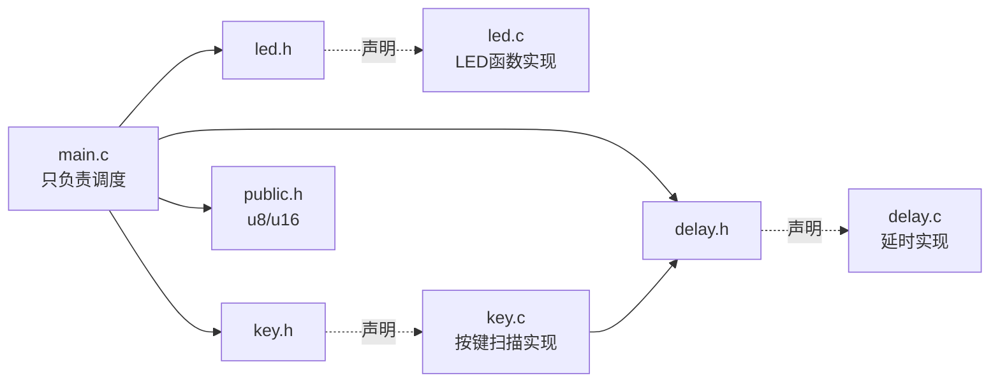

# 模块化编程 — 51单片机多文件工程

> 从「一个 main.c 塞满所有代码」到「一个功能一个模块，一个 `.c` 配一个 `.h`」。
> 这是从"能跑通实验"到"能写项目"的分水岭。

---

## 0. 一句话抓住核心

**`.h` 是菜单，`.c` 是后厨。**

- `.h`（头文件）：对外公开的**接口清单** —— 函数声明、宏、类型、外部变量声明。别人只看菜单。
- `.c`（源文件）：**具体实现** —— 函数代码、变量定义、`sbit` 引脚定义、`code` 常量表。后厨的活儿不对外。

模块化的本质不是"多写几个文件"，而是**把「能不能用」和「怎么实现」分开**。

---

## 1. 为什么必须模块化

你现在的实验代码都是单文件（`main.c` 里几百行），能跑，但会碰到这些问题：

| 痛点 | 单文件写法 | 模块化写法 |
|:---|:---|:---|
| 找函数 | 滚 800 行找 `key_scan()` | 直接打开 `key.c` |
| 复用 | 新工程要复制粘贴整段代码 | 把 `led.c/led.h` 拷过去即可 |
| 排错 | 改一处可能崩别处 | 模块边界清晰，问题范围缩小 |
| 协作 | 两个人没法同时改一个文件 | 一人一个模块，互不冲突 |
| 编译 | 改一行全量重编 | 只重编改动的 `.c` |

> 一句话：**单文件是"草稿"，模块化是"工程"**。第 2 期开始写定时器 + 按键 + 显示的复合功能时，单文件会直接失控。

---

## 2. 模块的组成：一对 `.c` + `.h`



**关键：箭头是单向的。**
- `main.c` 只 **include 头文件**，不 include 任何 `.c`。
- 模块之间也只用头文件互相"看见"，绝不 `#include "xxx.c"`（那样会把实现复制进两个文件，直接重复定义）。

### 2.1 文件职责对照表

| 内容 | 放 `.h` | 放 `.c` |
|:---|:---:|:---:|
| 函数**声明**（带分号，无函数体） | ✅ | ❌ |
| 函数**实现**（有函数体） | ❌ | ✅ |
| `#define` 宏、`typedef` 类型 | ✅ | 少量 |
| 全局变量**定义**（`u8 flag = 0;`） | ❌ | ✅ |
| 全局变量**声明**（`extern u8 flag;`） | ✅ | ❌ |
| `sbit` 引脚定义 | ⚠️ 不推荐 | ✅ |
| `code` 常量表**定义** | ❌ | ✅ |
| `code` 常量表**声明**（`extern code ...`） | ✅ | ❌ |
| `#include <reg52.h>` | 按需 | 按需 |

### 2.2 `static`：把内部实现藏起来

模块化的核心是"对外只暴露接口"。`static` 就是用来做这件事的——给"只在本文件用"的东西加上**内部链接**，让它对其他 `.c` 不可见。

```c
/* led.c */
static void led_write(u8 dat)   // 内部函数：只有 led.c 能调
{
    P2 = dat;
}

static u8 g_led_state = 0;       // 文件作用域变量：只在 led.c 可见

void led_on(u8 n)                // 对外接口（在 led.h 里声明）
{
    led_write(P2 & ~(1 << n));   // 内部函数随便用
}
```

| 写法 | 作用 | 类比 |
|:---|:---|:---|
| `static void f(void)` | 内部函数，别的 `.c` 调不到、也不会和外部同名函数冲突 | 后厨的小工具 |
| `static u8 x;` | 文件作用域变量，只在本 `.c` 可见 | 后厨的私货 |
| 不加 `static` 的全局变量/函数 | 外部链接，整个工程都能看到 | 菜单上的菜 |

> 记住：**模块内部的辅助函数一律加 `static`**。既避免和别的模块重名（Keil 报 MULTIPLE PUBLIC DEFINITIONS），又明确告诉读代码的人"这个函数只在本文件用"。

---

## 3. 头文件的"三件套 + 卫士"

一个规范的 `.h` 长这样（`delay.h`）：

```c
#ifndef __DELAY_H__          // ① 卫士：没定义过才继续
#define __DELAY_H__          // ② 立刻定义，防止第二次进来

#include "public.h"          // ③ 需要用到 u8/u16 就包含公共头

void delay_10us(u16 ten_us); // ④ 只写声明，末尾分号，没有花括号
void delay_ms(u16 ms);

#endif                       // ⑤ 卫士收尾
```

### 3.1 为什么必须有 `#ifndef` 卫士

同一份头文件可能被包含多次（`main.c` 包含 `led.h`，`led.h` 又包含了 `public.h`……）。没有卫士，`typedef` 和函数声明会重复出现，报 redefinition。这在多文件工程里是**必踩的坑**，提前防住。

> 命名规范：`__文件名_H__`，全大写，别用 `__FILE_H__` 这种容易撞车的名字。

### 3.2 头文件里只写"声明"

```c
// ✅ 声明：编译器只需要知道"有这么个函数，参数和返回值是什么"
void led_on(u8 n);

// ❌ 定义：有函数体，写在 .h 里被两个 .c 包含 → 重复定义
void led_on(u8 n) { P2 &= ~(1 << n); }
```

**声明 vs 定义**——这是模块化最核心的一组概念：

| | 声明（Declaration） | 定义（Definition） |
|:---|:---|:---|
| 作用 | 告诉编译器"有这个东西" | 真正分配内存 / 生成代码 |
| 出现次数 | 可以很多次 | **全工程只能一次** |
| 写法 | `void f(void);` / `extern u8 x;` | `void f(void){...}` / `u8 x = 0;` |
| 位置 | `.h` | `.c` |

### 3.3 预处理：编译前的那一步

所有以 `#` 开头的指令都不是 C 语法，而是交给**预处理器**在编译前执行的文本操作。C 程序的生成过程是四步：

```
.c / .h ──预处理──> 展开后的 .c ──编译──> .s(汇编) ──汇编──> .obj ──链接──> .hex
```

预处理器**只做文本替换和条件筛选，不做类型检查**。这就是为什么宏替换出错往往在编译阶段才暴露、且报错位置很难看。

模块化里最常用的预处理指令就两类：`#include`（插入文件）和条件编译（决定哪些代码参与编译）。

**`#include` 的本质：原样抄进来。**

```c
#include "led.h"
// 等价于把 led.h 的全部内容，原封不动地复制粘贴到这一行
```

所以 `.h` 不参与编译，它只是被"抄"进各个 `.c` 再一起编译——这也是为什么**函数/变量的定义不能写在 `.h` 里**：被抄进两个 `.c` 就变成两份定义，链接时重复。

**头文件卫士的三种写法：**

| 写法 | 说明 | 兼容性 |
|:---|:---|:---|
| `#ifndef __X_H__`<br>`#define __X_H__`<br>`...`<br>`#endif` | 最经典，判断宏是否已定义 | 所有编译器（含 Keil C51）✅ 推荐 |
| `#pragma once` | 写在文件第一行，编译器自己保证只含一次 | Keil C51 新版支持，老编译器可能不认 |
| `#if !defined(__X_H__)`<br>`#define __X_H__`<br>...<br>`#endif` | 等价于 `#ifndef`，但能和 `||` 组合多个条件 | 通用 |

> 跨平台/老项目老老实实写 `#ifndef`。它唯一的缺点是宏名可能撞车，所以用 `__模块名_H__` 这种命名。

### 3.4 条件编译：用 `#if` 控制代码开关

条件编译让你**按宏是否定义**来决定某段代码参不参与编译。51 工程里最常用的场景是「调试开关」和「模块开关」。

**常用指令表**：

| 指令 | 含义 |
|:---|:---|
| `#if 常量表达式` | 表达式非 0 时编译下面的代码 |
| `#ifdef 宏` | 宏已定义时编译（等价 `#if defined(宏)`） |
| `#ifndef 宏` | 宏未定义时编译 |
| `#elif` / `#else` / `#endif` | 分支 / 否则 / 结束 |
| `#undef 宏` | 取消一个宏的定义 |
| `#error "消息"` | 主动报错并终止编译（做配置校验） |

**场景 1：调试串口开关**

```c
/* main.c */
#include "uart.h"

void log_msg(u8 *str)
{
#ifdef DEBUG              // 只有定义了 DEBUG 才编译这段
    uart_send_string(str);
#endif
}

void main(void)
{
    log_msg("boot ok\n");  // 没定义 DEBUG 时，这行等于空函数调用
}
```

在 Keil 里：**Project → Options for Target → C51 → Define** 里填 `DEBUG`，就开启调试输出；量产时删掉这个宏，调试代码自动消失，不占 Flash。

**场景 2：模块开关（可选功能）**

```c
/* config.h */
#define USE_LCD1602   1    // 1=用 LCD，0=用数码管
```

```c
/* display.c */
#if USE_LCD1602
#include "lcd1602.h"
void display_show(u8 *s) { lcd_show_string(s); }
#else
#include "seg.h"
void display_show(u8 *s) { seg_show(s); }
#endif
```

改一个宏就能切换显示硬件，不用动 `main.c`。

**场景 3：编译期断言**

```c
#ifndef FOSC
#error "请在 config.h 中定义 FOSC（晶振频率）"
#endif
```

忘定义晶振频率时，编译直接给出清晰报错，而不是后面算出一堆奇怪的初值。

> 预定义宏（调试辅助）：`__FILE__`（当前文件名）、`__LINE__`（行号）、`__DATE__`、`__TIME__`。在 `#error` 或日志里带上行号，排错非常方便。

---

## 4. `extern`：跨文件共享变量

模块 A 想用模块 B 里的全局变量，不能直接写 `u8 key_value;`（那是**又定义了一份**），必须用 `extern` 声明。

```c
/* key.c */
u8 key_value = 0;          // ✅ 定义：真正分配内存，全工程唯一
```

```c
/* key.h */
extern u8 key_value;       // ✅ 声明：告诉别人"这个变量在别处定义了"
```

```c
/* main.c */
#include "key.h"
void main(void) {
    if (key_value == 1) { /* 用的是 key.c 里那一份 */ }
}
```

### 4.1 `extern` 的两个要点

1. **`extern` 不加初值**。`extern u8 x = 5;` 会被当成定义，编译报错。
2. **`code` 常量表也能 extern**：表在 `.c` 里 `code u8 gsmg_code[17] = {...};`，在 `.h` 里 `extern code u8 gsmg_code[17];`，多个模块共用一张段码表，不用各写一遍。

### 4.2 `sbit` 特殊处理（51 专属坑）

`sbit` 是**硬件地址的别名**，不是普通变量，**不能 `extern`**。如果把它写在公共头文件里、被两个 `.c` 包含，链接会报重复定义（L104 MULTIPLE PUBLIC DEFINITIONS）。

**正确做法**：谁的引脚谁管——`sbit LED1 = P2^0;` 写在 `led.c` 里，对外只暴露 `led_on()/led_off()` 这类函数。

> 好处是"封装"：`main.c` 不需要知道 LED 接在 P2.0，换板子只改 `led.c` 一行。

### 4.3 `extern` 对函数和变量的区别

很多人搞不清什么时候该写 `extern`，一句话区分：

| | 函数 | 变量 |
|:---|:---|:---|
| 头文件里的写法 | `void f(void);` | 必须 `extern u8 x;` |
| 是否默认 extern | ✅ 函数声明**默认就是** extern | ❌ `u8 x;` 会被当成**定义**（tentative definition） |
| 写 `extern` 有用吗 | 写不写都一样，多余 | **必须写**，否则重复定义 |

```c
/* xxx.h */
void f(void);              // ✅ 等价于 extern void f(void);
extern u8 g_flag;          // ✅ 必须加 extern

// ❌ 错误示范：
u8 g_flag;                 // 被多个 .c 包含 → 每个 .c 都定义了一份 → 链接报重复定义
```

> 口诀：**函数不用写 extern，变量必须写 extern**。

---

## 5. 完整例子：LED + 按键 拆成 4 个文件

### 5.1 目录结构

```
Project/
├── User/
│   └── main.c            ← 只做调度，不放实现
├── Hardware/
│   ├── led.c  / led.h    ← LED 模块
│   └── key.c  / key.h    ← 按键模块
├── System/
│   └── delay.c / delay.h ← 延时模块
└── Public/
    └── public.h          ← 公共类型 u8/u16
```

### 5.2 `public.h` — 公共类型

```c
#ifndef __PUBLIC_H__
#define __PUBLIC_H__

typedef unsigned char u8;
typedef unsigned int  u16;

#endif
```

### 5.3 `delay.c` / `delay.h`

```c
/* delay.h */
#ifndef __DELAY_H__
#define __DELAY_H__

#include "public.h"

void delay_10us(u16 ten_us);
void delay_ms(u16 ms);

#endif
```

```c
/* delay.c */
#include "delay.h"

void delay_10us(u16 ten_us)
{
    while (ten_us--) {
        ;                      /* 约 10us @11.0592MHz */
    }
}

void delay_ms(u16 ms)
{
    u16 i;
    for (i = 0; i < ms; i++) {
        delay_10us(100);
    }
}
```

### 5.4 `led.c` / `led.h`（封装引脚 + 位运算）

```c
/* led.h */
#ifndef __LED_H__
#define __LED_H__

#include "public.h"

void led_on(u8 n);       /* n = 0~7，对应 P2.0~P2.7 */
void led_off(u8 n);
void led_toggle(u8 n);

#endif
```

```c
/* led.c */
#include "led.h"
#include <reg52.h>

/* 低电平点亮：清 0 亮，置 1 灭 */
void led_on(u8 n)     { P2 &= ~(1 << n); }
void led_off(u8 n)    { P2 |=  (1 << n); }
void led_toggle(u8 n) { P2 ^=  (1 << n); }
```

> 这里复习了 [[单片机C编程地基#3. 位运算实战：怎么点某一盏灯 / 关某一位|位运算]]：`~` 取反配 `&` 清零，`|` 置位，`^` 翻转。

### 5.5 `key.c` / `key.h`（带消抖，模板来自 [[按键]]）

```c
/* key.h */
#ifndef __KEY_H__
#define __KEY_H__

#include "public.h"

u8 key_scan(void);       /* 返回 0=无按键，1=K1 按下 */

#endif
```

```c
/* key.c */
#include "key.h"
#include "delay.h"
#include <reg52.h>

sbit KEY1 = P3^1;        /* 引脚定义放 .c，不对外暴露 */

u8 key_scan(void)
{
    if (KEY1 == 0) {
        delay_ms(10);              /* 消抖 */
        if (KEY1 == 0) {
            while (KEY1 == 0);     /* 等松手 */
            return 1;
        }
    }
    return 0;
}
```

### 5.6 `main.c` — 只做调度

```c
/* main.c */
#include "public.h"
#include "led.h"
#include "key.h"
#include "delay.h"

void main(void)
{
    u8 key;

    while (1) {
        key = key_scan();
        if (key == 1) {
            led_toggle(0);         /* 按一下 K1，翻转 LED1 */
        }
    }
}
```

对比原来的单文件版本：`main.c` 从 100 行降到 15 行，**功能一眼看得清**，这就是模块化的收益。

---

## 6. Keil 实操：把 `.c` 加进工程

这是最容易卡住的一步——**文件写好了，但编译说找不到函数**。

| 步骤 | 操作 | 说明 |
|:---|:---|:---|
| ① 建文件 | 在工程目录建 `led.c`、`led.h`... | 用外部编辑器（VS Code）建也行 |
| ② 加 `.c` | 左侧 Project 树 → 右键 `Source Group 1` → **Add Existing Files to Group 'Source Group 1'** | **每个 `.c` 都必须加**，`.h` 不用加 |
| ③ 加目录 | 若 `.c/.h` 不在同一目录：Project → Options for Target → **C51** → **Include Paths** 添加文件夹 | 否则 `#include "led.h"` 找不到 |
| ④ 编译 | F7 / Build | 链接器自动把各 `.obj` 拼起来 |

### 6.1 编译链接到底发生了什么

```
led.c ──编译──> led.obj ─┐
key.c ──编译──> key.obj ─┼─链接器─> 最终 .hex
main.c ─编译──> main.obj ┘
```

- `.h` **不参与编译**，它只是被 `#include` **原样文本复制**进 `.c`（所以叫"头文件"）。
- 每个 `.c` 独立编译，互不知道对方写了什么，只知道头文件承诺的接口。
- 链接器最后按**符号名**把"调用"接到"定义"上。所以顺序无所谓，但**必须都在工程里**。

### 6.2 中断函数特殊写法

```c
/* timer0.c */
void timer0_isr(void) interrupt 1
{
    TH0 = 0xFC;  TL0 = 0x18;
    /* 处理 */
}
```

中断服务函数**只在本 `.c` 里定义，头文件不用声明**——因为它是硬件调用的，没有任何模块会去"调用"它。声明了反而容易让人误以为可以手动调用。（详见 [[定时器与中断]]）

---

## 7. 常见错误对照表

| 现象 | 原因 | 修法 |
|:---|:---|:---|
| `UNRESOLVED EXTERNAL SYMBOL`（未解析外部符号） | 函数声明了但没实现；或 `.c` 没 Add 进工程 | 补实现 / Add 文件 |
| `MULTIPLE PUBLIC DEFINITIONS`（L104 重复定义） | 变量/函数**定义**写在了 `.h` 里，被多个 `.c` 包含 | 定义移到 `.c`，`.h` 改 `extern` |
| `sbit` 重复定义 | `sbit` 写在公共头文件 | 移到具体模块的 `.c` |
| `undefined identifier 'P2'` | 忘了 `#include <reg52.h>` | 在用到寄存器的 `.c` 里补上头文件 |
| `redefinition of 'u8'` | 头文件没有 `#ifndef` 卫士 | 加卫士 |
| 改了代码但不生效 | `.c` 不在工程里，编译的是旧文件 | 检查 Project 树 |
| 报"函数无原型"警告 | `.h` 里漏了声明 | 补声明 |
| 报 `unknown type name` / 类型循环 | A.h 包含 B.h，B.h 又包含 A.h（循环依赖） | 见 7.1 |

### 7.1 循环包含：A.h ↔ B.h 的死结

两个头文件互相 `#include` 对方，即使都有卫士，也会出现"先用到的类型还没定义"的错误：

```c
/* a.h */
#ifndef __A_H__
#define __A_H__
#include "b.h"              // 先抄 b.h，而 b.h 又要抄 a.h → a.h 还没展开完
typedef struct { B b; } A;  // B 还没定义，报错
#endif
```

**解法**：头文件之间**不要互相 include**。

1. 把双方都需要的类型（`u8/u16`、公共结构体）放进 `public.h`，大家都只 include `public.h`；
2. 如果 A 模块需要调 B 模块的函数，在 **`a.c` 里** `#include "b.h"`，而不是在 `a.h` 里；
3. 实在要在头文件里引用对方的类型，用**前向声明**：`typedef struct B B;`（只声明名字，不展开结构体），真正的结构体定义放 `.c` 或 `public.h`。

> 原则：**`.h` 只暴露自己的接口，不依赖别人的实现细节**。依赖关系永远是单向的。

---

## 8. 工程命名与组织约定

| 约定 | 做法 | 理由 |
|:---|:---|:---|
| 文件名 | 全小写，模块名同名（`led.c` / `led.h`） | Windows 不区分大小写，跨平台/版本管理不踩坑 |
| 一个模块 | 只干一件事（`led` 只管灯，`key` 只管按键） | 职责单一才好复用 |
| 只在本文件用的函数 | 加 `static`（`static void led_write(u8 dat)`） | 限制作用域，避免和别的模块重名 |
| 硬件引脚 | 集中在模块 `.c` 顶部，或单独 `board.h` | 换板子只改一处 |
| 公共类型 | 统一 `public.h`，不要每个 `.h` 都 typedef 一遍 | 避免重复定义 |
| 目录 | `User/` 放 main，`Hardware/` 放外设，`System/` 放工具 | 工程一大就靠目录说话 |

---

## 9. 重构四步法（把旧工程拆开）

1. **分类**：打开旧的 `main.c`，把函数按功能分堆（延时一堆、LED 一堆、按键一堆）。
2. **配对**：每堆建一对 `.c/.h`，实现搬进 `.c`，声明抄进 `.h`（记得加卫士）。
3. **清主文件**：`main.c` 删掉所有实现，顶部改成 `#include "xxx.h"`。
4. **进工程**：Keil 里 Add 所有 `.c` → 编译 → 对照第 7 节错误表修。

> 建议拿你现在的「按键控制 LED 流水灯」工程练手，拆成 `main / led / key / delay` 四个模块。拆完再编译通过，这一节就真的会了。

---

## 10. 知识连接

- 骨架认知：[[51单片机C语言实战#3.1 读懂官方源码的通用骨架|官方源码 8 段骨架]] —— 模块化就是把这 8 段拆到不同文件。
- 类型与宏：[[工具库#3. `typedef` — 类型重定义（你的编码习惯）|typedef]] / [[工具库#4. `#define` — 宏定义端口（你的编码习惯）|#define]] —— 放进 `.h` 就是"对外接口"的一部分。
- 硬件别名：[[单片机C编程地基#2. `sfr` 与 `sbit`：给寄存器和引脚起名字|sbit]] —— 解释了为什么 `sbit` 不能随便放头文件。
- 预处理基础：[[预处理指令]] —— `#include` / `#define` / `#if` 系列指令的系统讲解，本笔记只覆盖模块化用得到的部分。
- 实践对象：[[LED]] · [[按键]] · [[动态数码管]]（段码表用 `extern code` 共享）。
- 下一步：[[定时器与中断]] —— 第 2 期会把 `delay.c` 换成定时器，模块化的好处立刻显现：只替换一个文件，其他模块不用动。

---

## 11. 自测清单

- [ ] 能说清 `.h` 和 `.c` 各放什么，以及"声明 vs 定义"的区别
- [ ] 能默写带头文件卫士的 `.h` 模板，知道 `#pragma once` 是另一种写法
- [ ] 会用 `extern` 共享一个全局变量和一张 `code` 表，并能说清函数和变量的 extern 区别
- [ ] 知道 `sbit` 为什么不能写进公共头文件
- [ ] 知道 `static` 在模块化里是干什么的，会给内部函数加 `static`
- [ ] 能用 `#ifdef DEBUG` 做一个调试开关，并知道在 Keil 哪里定义这个宏
- [ ] 知道两个头文件互相 include 会出什么问题，以及怎么解
- [ ] 能在 Keil 里把多个 `.c` 加进同一个工程并编译通过
- [ ] 能把「按键控制 LED」单文件工程拆成 4 个模块

---

> 📌 记忆口诀：**头声明、源实现、加工程、防重含**。

## 相关笔记

- 索引：[[51单片机MOC]] · [[学习画像]]
- 前置：[[单片机C编程地基]]
- 关联：[[工具库]] · [[LED]]（.c/.h 拆分实例） · [[代码规范]]（注释、命名与目录约定）

---

## 🧭 阅读顺序

⬅️ 上一篇：[[单片机C编程地基]] ｜ ➡️ 下一篇：[[GPIO]] ｜ 🏠 返回索引：[[51单片机MOC]]
