# LCD1602 字符液晶

> 根据前面学习的 LCD1602 驱动代码，以及普中 A2 开发板原理图中 LCD
> 接线整理。配图存放在本仓库 `images/LCD1602/` 目录。


## 0. 配图索引

### 接线与时序

以下配图按普中 A2 当前接线和本文驱动逻辑绘制。

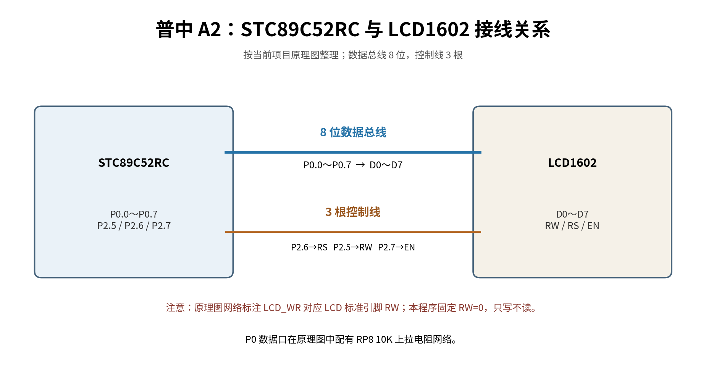

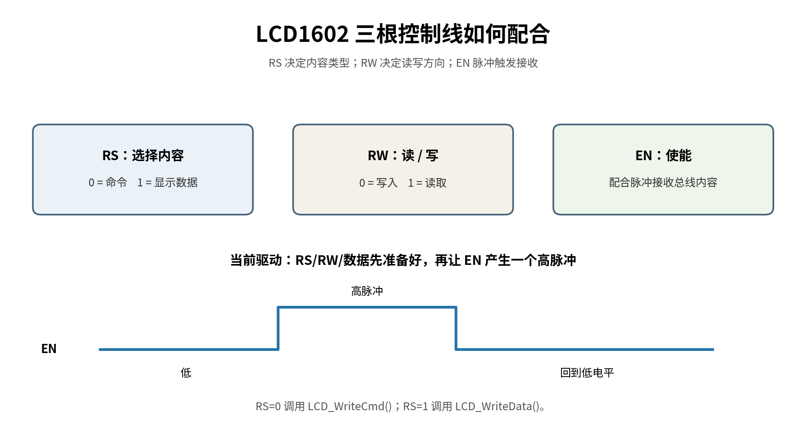

### 教学插图

这些是专门为本笔记绘制的教学插图，包含 LCD 模块外观示意、字符位置、接口功能和数字转换过程。

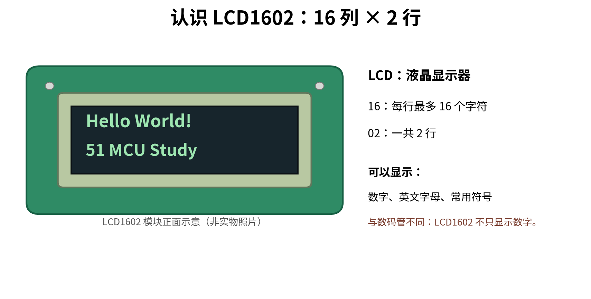

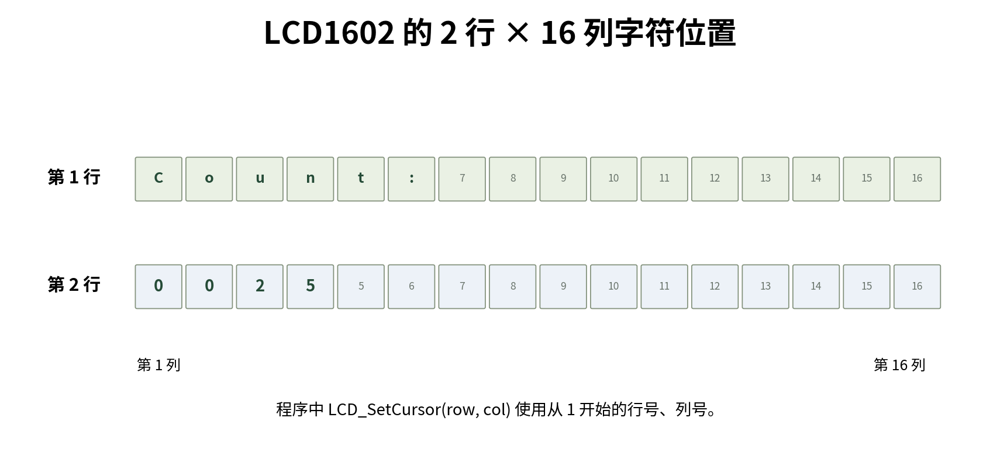

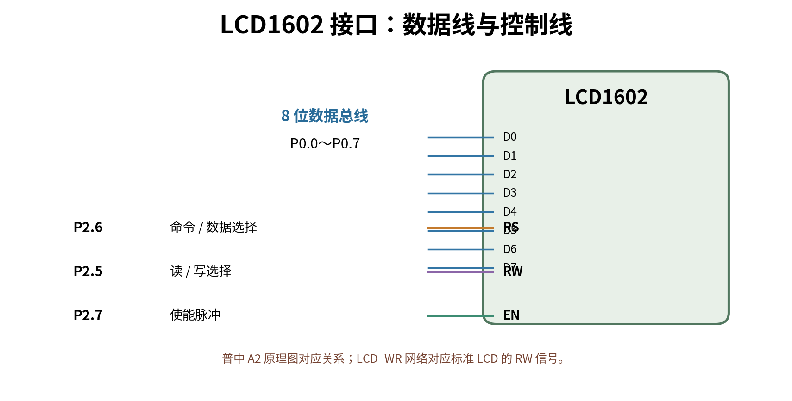

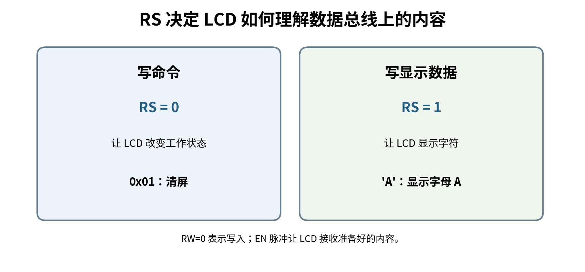

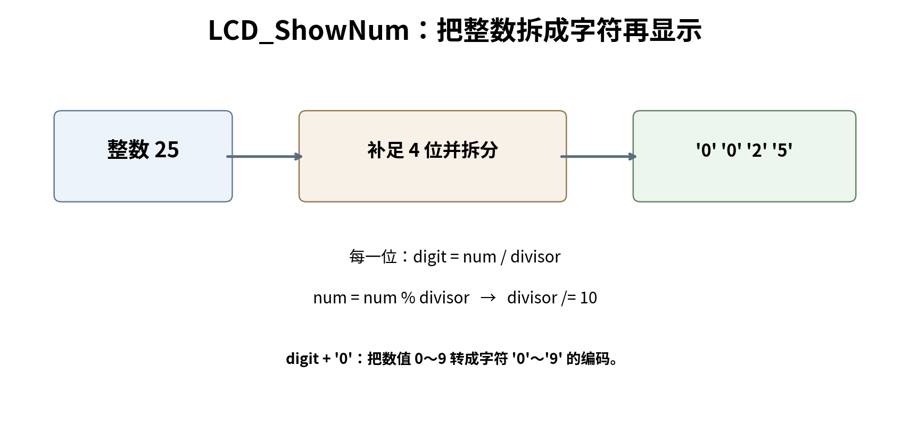

## 1. LCD1602 是什么？

LCD1602 是字符型液晶屏：每行显示 16 个字符，共 2
行。它不是点阵图形屏，主要显示数字、英文和常用符号。

``` text
┌────────────────┐
│ Count:         │  第 1 行，16 个字符位
│ 0025           │  第 2 行，16 个字符位
└────────────────┘
```

## 2. 普中 A2 开发板接线


根据当前使用的普中 A2 原理图：

| LCD 信号 | 单片机引脚 | 作用 |
|:--|:--|:--|
| D0～D7 | P0.0～P0.7 | 8 位数据总线 |
| RS | P2.6 | 命令/数据选择 |
| RW（原理图网络标注 LCD_WR） | P2.5 | 读/写选择 |
| EN | P2.7 | 使能信号 |

原理图中 P0 数据口配置了 RP8 10K 上拉电阻网络。LCD1602
有预留排母，可按开发板设计直接插接；不需要为了显示功能擅自增加 DS1302
等外接模块。

``` text
STC89C52RC                    LCD1602
┌─────────────┐              ┌──────────┐
│ P0.0 ───────┼─────────────►│ D0       │
│ P0.1 ───────┼─────────────►│ D1       │
│ P0.2 ───────┼─────────────►│ D2       │
│ P0.3 ───────┼─────────────►│ D3       │
│ P0.4 ───────┼─────────────►│ D4       │
│ P0.5 ───────┼─────────────►│ D5       │
│ P0.6 ───────┼─────────────►│ D6       │
│ P0.7 ───────┼─────────────►│ D7       │
│ P2.6 ───────┼─────────────►│ RS       │
│ P2.5 ───────┼─────────────►│ RW       │
│ P2.7 ───────┼─────────────►│ EN       │
└─────────────┘              └──────────┘
```

## 3. 引脚功能与内部结构

### 16 个引脚

| 引脚 | 名称 | 作用 |
|:--:|:--|:--|
| 1 | VSS | 电源地（GND） |
| 2 | VDD | 电源正，5 V |
| 3 | V0 | 对比度调节，接电位器中间抽头（普中 A2 已板载） |
| 4 | RS | 0 = 指令，1 = 数据 |
| 5 | RW | 0 = 写，1 = 读 |
| 6 | EN | 使能，下降沿时 LCD 锁存总线内容 |
| 7～14 | D0～D7 | 8 位数据总线（4 位模式只用 D4～D7） |
| 15 | A | 背光正极，需串限流电阻 |
| 16 | K | 背光负极 |

前 6 个引脚决定“这次通信是什么性质”，后 8 个是数据通道。背光 A/K 只影响亮不亮，和显示内容无关，因此“有背光但没字符”时要查的是对比度和控制线，不是背光。

### 芯片内部有什么

| 部件 | 容量 | 作用 |
|:--|:--|:--|
| DDRAM | 80 字节 | 显示数据存储器，存的是**字符编码**；屏幕只显示其中 32 个单元 |
| CGROM | 内置字库 | 固化约 192 个 5×7 点阵字符（数字、大小写字母、符号、日文假名） |
| CGRAM | 64 字节 | 自定义字符区，可存 8 个 5×7 字符，编号 0x00～0x07 |
| AC | 7 位 | 地址计数器，指向下一次读写的 DDRAM/CGRAM 单元，读写后自动 ±1 |
| BF | 1 位 | 忙标志，1 表示内部正在执行指令，此时不接收新指令 |

一句话：**写数据不是画点，而是往 DDRAM 的当前地址放一个字符编码**，LCD 再拿这个编码去 CGROM / CGRAM 里查字模，点亮对应的点阵。

## 4. DDRAM 地址与显示位置

DDRAM 一共 80 字节，分两段存放；屏幕每行只取前 16 个：

| 区域 | 地址范围 | 实际显示 |
|:--|:--|:--|
| 第 1 行 | 0x00～0x27 | 0x00～0x0F（16 个字符位） |
| 第 2 行 | 0x40～0x67 | 0x40～0x4F（16 个字符位） |

| 显示位置 | DDRAM 地址 | 写入的地址指令 |
|:--|:--:|:--:|
| 第 1 行第 1 列 | 0x00 | 0x80 |
| 第 1 行第 16 列 | 0x0F | 0x8F |
| 第 2 行第 1 列 | 0x40 | 0xC0 |
| 第 2 行第 16 列 | 0x4F | 0xCF |

规律：**地址指令 = 0x80 | DDRAM 地址**。

由此能解释两个常见现象：

- 第一行写到第 16 个字符后，AC 会继续加到 0x10～0x27，这些地址不在屏幕上，于是“继续写却看不见”，必须手动设置第二行地址（0xC0）。
- 第二行起始地址不是紧接着的 0x10，而是 0x40，这是 1602 的硬件划分，不是笔误。

## 5. 字符编码与 CGRAM

### 写入的是编码，不是图形

| 写入值 | 显示内容 |
|:--:|:--|
| 0x20 | 空格 |
| 0x30～0x39 | `0`～`9` |
| 0x41～0x5A | `A`～`Z` |
| 0x61～0x7A | `a`～`z` |

0x20～0x7E 与标准 ASCII 一致，所以在 C 语言里直接写 `'A'`、`"Count:"` 就能显示。0xA0 以上是日文假名和特殊符号，不做本地化时基本用不到，这也正是“1602 只能显示数字、英文和常用符号”的原因。

### CGRAM：自己造 8 个字符

CGRAM 共 64 字节 = 8 个字符 × 每个 8 字节。每个字符用 8 行点阵描述，每行只有低 5 位有效（D4～D0），写 1 的位置点亮。

写入步骤：

1. 发 `0x40 | (编号 × 8)`，把 AC 指向 CGRAM 对应单元；
2. 连续写 8 个字节的点阵数据；
3. 发 `0x80 | 位置`，把 AC 切回 DDRAM；
4. 之后写编号 `0x00`～`0x07`，屏幕上就显示该自定义字符。

``` c
// 自定义字符 0：一个 5×7 的向上箭头
unsigned char code ArrowChar[8] = {
    0x04,   // ..█..
    0x0E,   // .███.
    0x1F,   // █████
    0x04,   // ..█..
    0x04,   // ..█..
    0x04,   // ..█..
    0x04,   // ..█..
    0x00    // 空行
};

void LCD_LoadChar(unsigned char num, unsigned char *dots)
{
    unsigned char i;

    LCD_WriteCmd(0x40 | (num << 3));   // CGRAM 地址 = 0x40 | 编号×8
    for(i = 0; i < 8; i++)
        LCD_WriteData(dots[i]);

    LCD_WriteCmd(0x80);                // 回到 DDRAM 第 1 行第 1 列
}
```

调用 `LCD_LoadChar(0, ArrowChar)` 之后，`LCD_WriteData(0x00)` 就会显示这个箭头。编号 0x00～0x07 原本属于控制字符区，正好拿来放自定义图案。

## 6. 8 位与 4 位接线方式

| 对比项 | 8 位模式 | 4 位模式 |
|:--|:--|:--|
| 数据线 | D0～D7 共 8 根 | 只用 D4～D7 共 4 根 |
| 送一个字节 | 一次送完 | 先送高 4 位，再送低 4 位 |
| 功能设置指令 | `0x38` | `0x28` |
| 初始化 | 直接发 `0x38` | 先按 8 位方式发 3 次 `0x3`，再发 `0x28` |
| IO 占用 | 多 4 个 | 省 4 个 IO |
| 速度 | 略快 | 每个字节要两次使能脉冲，略慢 |
| 普中 A2 | 采用 8 位 | 未使用 |

4 位模式下，一个字节分两次送：

``` c
LCD_DATA = dat & 0xF0;          // 先送高 4 位（D4～D7）
LCD_EN = 1; _nop_(); _nop_(); LCD_EN = 0;

LCD_DATA = (dat << 4) & 0xF0;   // 再送低 4 位
LCD_EN = 1; _nop_(); _nop_(); LCD_EN = 0;
```

要点：高 4 位永远走在前面，并且两次都必须落在 D4～D7 上。省下来的 4 个 IO 在 IO 紧张时很有价值，代价是驱动代码多一层拆分，初始化也要多一步“先把总线切到 4 位”。

## 7. 三根控制线


### RS：选择命令或数据

-   `RS = 0`：写命令，例如清屏、设置光标。
-   `RS = 1`：写显示数据，例如字符 `'A'`、字符 `'1'`。

### RW：选择读或写

-   `RW = 0`：向 LCD 写入。
-   `RW = 1`：从 LCD 读取。

当前驱动只向 LCD 写入，因此固定
`LCD_RW = 0`，不读取忙标志，而是通过延时等待 LCD 完成操作。

### EN：使能

先准备 RS、RW 和数据，再给 EN 一个脉冲，让 LCD 接收总线上的内容。

``` text
准备 RS / RW / 数据
        ↓
      EN=0
        ↓
      EN=1   ← 使能脉冲
        ↓
      EN=0
        ↓
    等待 LCD 完成
```

## 8. 写命令与写数据

**写命令**用于改变 LCD 的工作状态；**写数据**用于显示字符。

``` c
void LCD_WriteCmd(unsigned char cmd)
{
    LCD_RS = 0;       // 选择命令
    LCD_RW = 0;       // 写入
    LCD_EN = 0;
    LCD_DATA = cmd;   // 命令放到数据总线
    LCD_EN = 1;
    _nop_();
    _nop_();
    LCD_EN = 0;
    DelayMs(2);
}
```

``` c
void LCD_WriteData(unsigned char dat)
{
    LCD_RS = 1;       // 选择显示数据
    LCD_RW = 0;       // 写入
    LCD_EN = 0;
    LCD_DATA = dat;   // 字符编码放到数据总线
    LCD_EN = 1;
    _nop_();
    _nop_();
    LCD_EN = 0;
    DelayMs(2);
}
```

两者的核心区别是 `RS`：命令函数令 RS=0，数据函数令 RS=1。

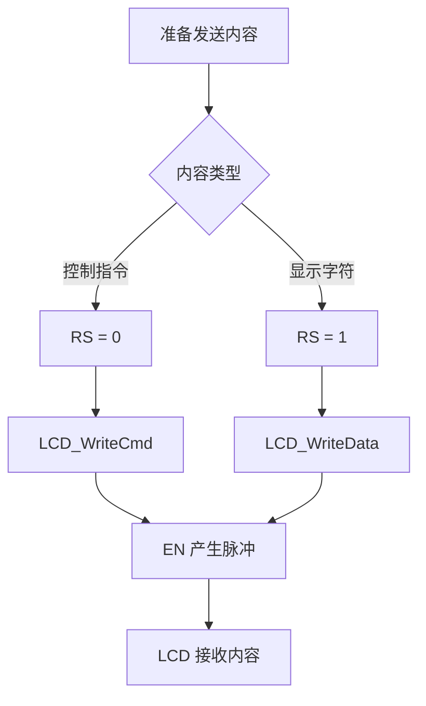

## 9. 指令集

LCD1602（HD44780 兼容）一共只有十来条指令。它们都以 `RS = 0`、`RW = 0` 写入，数据口上的 8 位就是指令码本身：高位既标识“这是哪一族指令”，也携带参数。

### 指令总表

| 指令 | RS | RW | 代码范围 | 作用 | 执行时间 |
|:--|:--:|:--:|:--:|:--|:--:|
| 清屏 | 0 | 0 | `0x01` | DDRAM 全部填空格，AC=0，光标回 (1,1) | 1.52 ms |
| 返回 Home | 0 | 0 | `0x02` | AC=0，光标回 (1,1)，显示内容不变 | 1.52 ms |
| 入口模式设置 | 0 | 0 | `0x04`～`0x07` | 写入后 AC 加/减、画面是否跟随 | 37 µs |
| 显示开关控制 | 0 | 0 | `0x08`～`0x0F` | 显示、光标、闪烁三个开关 | 37 µs |
| 光标/显示移位 | 0 | 0 | `0x10`～`0x1F` | 光标左右移，或整屏左右移 | 37 µs |
| 功能设置 | 0 | 0 | `0x20`～`0x3F` | 总线位数、行数、字库点阵 | 37 µs |
| 设置 CGRAM 地址 | 0 | 0 | `0x40`～`0x7F` | AC 指向自定义字符区 | 37 µs |
| 设置 DDRAM 地址 | 0 | 0 | `0x80`～`0xFF` | AC 指向显示区，即定位光标 | 37 µs |
| 读忙标志与 AC | 0 | 1 | — | DB7=BF，DB6～DB0=AC | — |
| 写数据 | 1 | 0 | 任意 | 把字符编码写进当前单元 | 37 µs |
| 读数据 | 1 | 1 | — | 读出当前单元内容 | 37 µs |

代码范围的划分本身就说明了指令结构：`0x01`、`0x02` 是独立的单条指令；`0x04`～`0x3F` 按“位 2～位 4 置 1”分族，各族内低位是参数；`0x40` 以上开始带地址。

### 清屏 Clear Display（`0x01`）

| 位 | DB7～DB1 | DB0 |
|:--|:--:|:--:|
| 值 | 0 | 1 |

执行后 DDRAM 全部写入 `0x20`（空格），AC 清零，光标回到左上角，入口模式恢复为 I/D=1。它是所有指令里最慢的之一（1.52 ms），发完必须等。

### 返回 Home Return Home（`0x02`）

DB1=1，其余为 0。作用只是 AC=0、光标回左上角；如果之前做过整屏移位，显示窗口也一并复位。

| 对比 | `0x01` 清屏 | `0x02` 返回 Home |
|:--|:--|:--|
| DDRAM 内容 | 全部清成空格 | 原样保留 |
| 光标 | 回 (1,1) | 回 (1,1) |
| 典型用途 | 换页、重新开始显示 | 回开头覆盖写，不清掉旧内容 |

### 入口模式设置 Entry Mode Set（`0x04`～`0x07`）

| 位 | 名称 | 含义 |
|:--:|:--:|:--|
| DB2 | 指令标志 | 固定为 1 |
| DB1 | I/D | 1 = 写入后 AC 加 1（从左往右写）；0 = AC 减 1（从右往左写） |
| DB0 | S | 1 = 写入时整屏跟随左移；0 = 画面不动 |

| 代码 | I/D | S | 效果 |
|:--:|:--:|:--:|:--|
| `0x06` | 1 | 0 | 常规写法：光标随字符右移 |
| `0x04` | 0 | 0 | 从右往左写 |
| `0x07` | 1 | 1 | 每写一个字符，整屏左移一格 |
| `0x05` | 0 | 1 | 每写一个字符，整屏右移一格 |

它决定“下一个字符写到哪里”，所以必须在写数据之前设定。

### 显示开关控制 Display ON/OFF（`0x08`～`0x0F`）

| 位 | 名称 | 含义 |
|:--:|:--:|:--|
| DB2 | D | 1 = 开显示；0 = 关显示（内容仍保留，只是不亮） |
| DB1 | C | 1 = 显示下划线光标 |
| DB0 | B | 1 = 光标处字符整字闪烁 |

| 代码 | 效果 |
|:--:|:--|
| `0x08` | 显示关、光标关、闪烁关 |
| `0x0C` | 显示开、无光标、无闪烁（本笔记采用） |
| `0x0E` | 显示开 + 下划线光标 |
| `0x0F` | 显示开 + 光标 + 闪烁 |

调试时临时改成 `0x0F`，就能看到光标停在哪里，定位写入位置非常直观。

### 光标与显示移位 Cursor or Display Shift（`0x10`～`0x1F`）

| 位 | 名称 | 含义 |
|:--:|:--:|:--|
| DB4 | 指令标志 | 固定为 1 |
| DB3 | S/C | 0 = 移光标（改变 AC）；1 = 移整屏（只移显示窗口，不改 DDRAM） |
| DB2 | R/L | 0 = 左移；1 = 右移 |
| DB1、DB0 | 固定 | 0 |

| 代码 | 效果 |
|:--:|:--|
| `0x10` | 光标左移一格 |
| `0x14` | 光标右移一格 |
| `0x18` | 整屏左移一格 |
| `0x1C` | 整屏右移一格 |

注意：整屏移位不改 DDRAM 内容，也不改 AC，所以适合做滚动提示，之后仍按原地址继续写。

### 功能设置 Function Set（`0x20`～`0x3F`）

| 位 | 名称 | 含义 |
|:--:|:--:|:--|
| DB4 | 指令标志 | 固定为 1 |
| DB3 | DL | 1 = 8 位数据总线；0 = 4 位数据总线 |
| DB2 | N | 1 = 双行显示；0 = 单行 |
| DB1 | F | 1 = 5×10 点阵；0 = 5×7 点阵 |
| DB0 | 固定 | 0 |

| 代码 | 配置 |
|:--:|:--|
| `0x38` | 8 位总线、双行、5×7（本笔记采用） |
| `0x28` | 4 位总线、双行、5×7 |
| `0x30` | 8 位总线、单行、5×7 |

它必须最先发送：在它生效之前，LCD 还不知道后续字节该按几位接收，所以初始化第一条永远是功能设置。

### 设置 CGRAM 地址 Set CGRAM Address（`0x40`～`0x7F`）

DB6～DB0 是 6 位地址（0～63），指令码 = `0x40 | 地址`。因为每个自定义字符占 8 字节，所以地址 = 字符编号 × 8：编号 0 对应 `0x40`，编号 1 对应 `0x48`，编号 7 对应 `0x78`。

### 设置 DDRAM 地址 Set DDRAM Address（`0x80`～`0xFF`）

DB6～DB0 是 7 位地址，指令码 = `0x80 | 地址`。第一行首地址 0x00 → `0x80`，第二行首地址 0x40 → `0xC0`，与第 11 节的 `LCD_SetCursor()` 完全对应。

设置一次地址、接着连续写一串字符，就是 `LCD_ShowString()` 能“自己往后写”的原因：每写一个字符，AC 按入口模式的 I/D 自动 ±1。

### 读忙标志与 AC（RS=0，RW=1）

| 位 | 含义 |
|:--:|:--|
| DB7 | BF 忙标志：1 = 正在执行指令，0 = 空闲 |
| DB6～DB0 | AC 当前地址 |

读操作时 LCD 在 EN=1 期间把内容放到总线，读完把 EN 拉低。51 的 P0 是准双向口，读之前必须先写 1：

``` c
void LCD_WaitBusy(void)
{
    LCD_DATA = 0xFF;     // P0 准双向口，读之前先写 1
    LCD_RS = 0;          // 读的是状态，不是数据
    LCD_RW = 1;

    do
    {
        LCD_EN = 1;
        _nop_();
        _nop_();
        LCD_EN = 0;
    } while(LCD_DATA & 0x80);   // BF 仍为 1 就继续等

    LCD_RW = 0;
}
```

### 指令执行时间

| 指令 | 执行时间 |
|:--|:--:|
| 清屏、返回 Home | 1.52 ms |
| 其余指令、读写数据 | 约 37 µs |

这就是“为什么清屏后要单独延时，而普通写字符延时 2 ms 也足够”的依据：延时只要覆盖最长的那条指令，逻辑就不会出错。

## 10. LCD 初始化

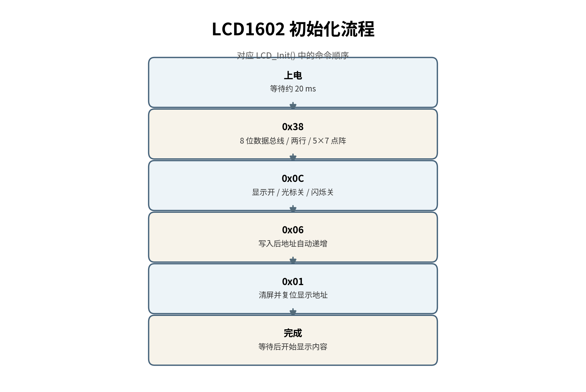

``` c
void LCD_Init(void)
{
    DelayMs(20);
    LCD_WriteCmd(0x38);
    LCD_WriteCmd(0x0C);
    LCD_WriteCmd(0x06);
    LCD_WriteCmd(0x01);
    DelayMs(5);
}
```

| 命令 | 含义 |
|:--:|:--|
| `0x38` | 8 位数据总线、两行显示、5×7 点阵 |
| `0x0C` | 显示开、光标关、闪烁关 |
| `0x06` | 写入字符后地址自动递增 |
| `0x01` | 清屏，显示地址复位 |

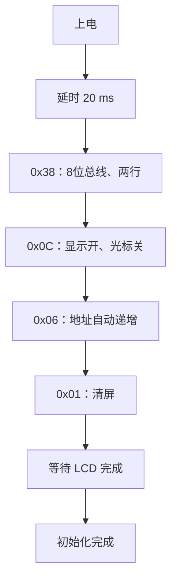

记忆：先配置接口和显示方式，再打开显示、设置写入方向，最后清屏。`0x01`
清屏操作需要等待，因此代码中安排了延时。

### 为什么要按这个顺序

1. **上电延时 20 ms**：VDD 稳定后 LCD 内部复位需要 15 ms 以上，这期间发指令会被忽略。
2. **`0x38` 功能设置**：先确定总线宽度、行数和字库，后面的指令才会被正确解释。
3. **`0x0C` 显示开关**：接口配置好再打开显示。此时 DDRAM 里还是上电随机值，先别急着亮屏。
4. **`0x06` 入口模式**：确定写入方向，必须早于任何一次写数据。
5. **`0x01` 清屏**：把前面的随机内容清成空格，同时让 AC=0，保证之后 `LCD_ShowString(1, 1, ...)` 一定从左上角开始。
6. **末尾 `DelayMs(5)`**：`0x01` 需要 1.52 ms，留足余量。

也可以先清屏再开显示，效果相同；但“功能设置永远第一、清屏放在写数据之前”这两条不能变。

### 严格的上电时序

数据手册给出的上电流程更保守：VDD 上升后等 15 ms 以上，再连续发三次 `0x38`（每次间隔 4.1 ms 以上），之后才进入正常指令流。重复三次是因为此时总线模式还没确定，只能按 8 位模式发单字节，确保 LCD 无论处于什么内部状态都能重新同步。

本笔记代码只发一次，是因为板子供电稳定、前面的 20 ms 延时也充足。如果遇到“上电偶尔不显示、复位一下就正常”，改成下面这样最稳：

``` c
DelayMs(50);
LCD_WriteCmd(0x38);  DelayMs(5);
LCD_WriteCmd(0x38);  DelayMs(5);
LCD_WriteCmd(0x38);
LCD_WriteCmd(0x0C);
LCD_WriteCmd(0x06);
LCD_WriteCmd(0x01);
DelayMs(5);
```

这里的 `DelayMs(5)` 是额外加的：`LCD_WriteCmd()` 内部只有 2 ms，覆盖不了 4.1 ms 的等待要求。

### 延时等待还是查忙标志

| 方式 | 做法 | 优点 | 缺点 |
|:--|:--|:--|:--|
| 延时等待 | 每条指令后 `DelayMs(2)` | 简单，不需要读总线 | 慢；延时不够就出错 |
| 查忙标志 | 读 BF，为 0 再发下一条 | 快且可靠，不受指令长短影响 | 需要 RW 可控，多一个函数 |

当前驱动采用延时法：RW 固定为 0，两条写函数末尾统一 `DelayMs(2)`，足以覆盖 37 µs 的普通指令；清屏这类 1.52 ms 的指令则单独补延时。

要改成查忙法，把写函数里的 `DelayMs(2)` 换成 `LCD_WaitBusy()` 即可——普中 A2 的 RW 接在 P2.5，本来就是可控的，只是当前代码把它固定成了 0。

## 11. 设置光标位置


``` c
void LCD_SetCursor(unsigned char row, unsigned char col)
{
    if(row == 1)
        LCD_WriteCmd(0x80 + col - 1);
    else if(row == 2)
        LCD_WriteCmd(0xC0 + col - 1);
}
```

本函数的行、列编号从 1 开始：

| 位置 | 地址命令 |
|:--|:--:|
| 第 1 行第 1 列 | `0x80` |
| 第 1 行第 2 列 | `0x81` |
| 第 1 行第 16 列 | `0x8F` |
| 第 2 行第 1 列 | `0xC0` |
| 第 2 行第 2 列 | `0xC1` |
| 第 2 行第 16 列 | `0xCF` |

例如 `LCD_SetCursor(2, 3)` 表示第二行第三列。减 1 是因为函数列号从 1
开始，而地址偏移从 0 开始。

## 12. 显示字符串

``` c
void LCD_ShowString(unsigned char row, unsigned char col,
                    unsigned char *str)
{
    LCD_SetCursor(row, col);
    while(*str != '\0')
    {
        LCD_WriteData(*str);
        str++;
    }
}
```

例如：

``` c
LCD_ShowString(1, 1, "Count:");
```

执行逻辑：

1.  设置起始位置。
2.  `*str` 取出当前字符。
3.  `LCD_WriteData(*str)` 显示该字符。
4.  `str++` 指针移动到下一个字符。
5.  遇到字符串结束符 `\0` 后退出。

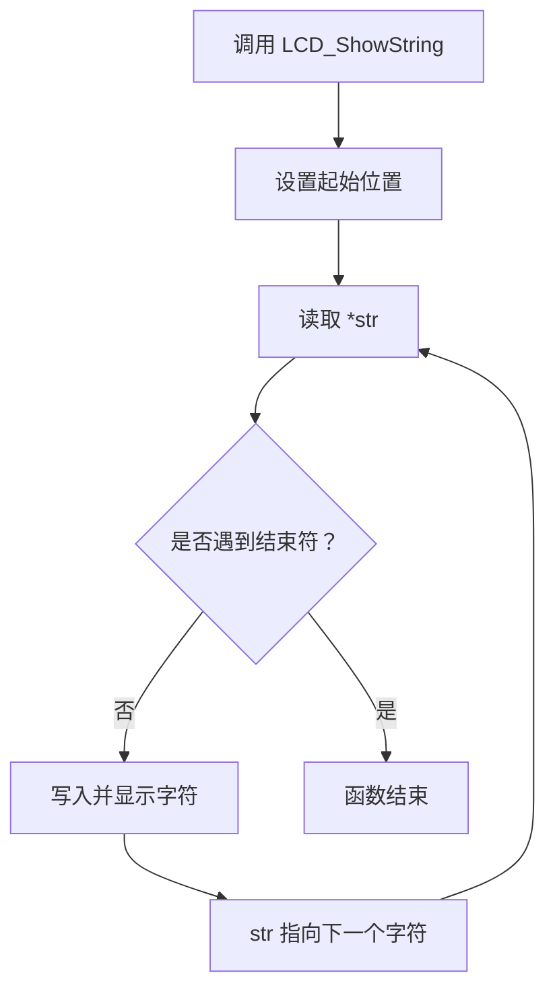

注意：`str++` 移动的是指针，不是把字符内容加 1。

## 13. 显示数字：LCD_ShowNum


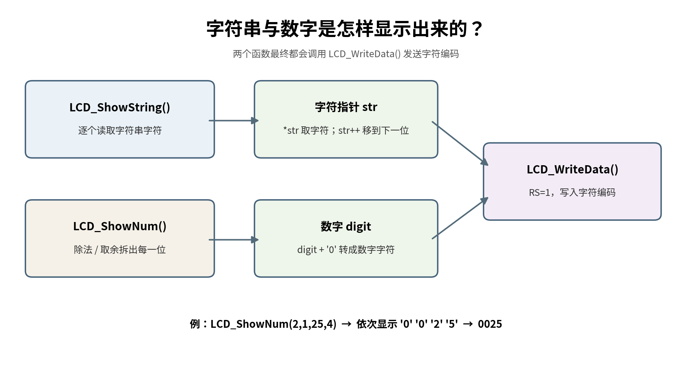

``` c
void LCD_ShowNum(unsigned char row, unsigned char col,
                 unsigned int num, unsigned char len)
{
    unsigned int divisor = 1;
    unsigned char i;
    unsigned char digit;

    for(i = 1; i < len; i++)
        divisor *= 10;

    LCD_SetCursor(row, col);

    for(i = 0; i < len; i++)
    {
        digit = num / divisor;
        LCD_WriteData(digit + '0');
        num = num % divisor;
        divisor /= 10;
    }
}
```

参数：`row` 行号，`col` 起始列，`num` 要显示的整数，`len` 固定显示位数。

例如：

``` c
LCD_ShowNum(2, 1, 25, 4);
```

显示 `0025`，即不足位数时在前面补 0。

以 `num=253`、`len=4` 为例：

| 轮次 | divisor | digit | 输出 | 取余后的 num |
|:--:|:--:|:--:|:--:|:--:|
| 1 | 1000 | 0 | `0` | 253 |
| 2 | 100 | 2 | `2` | 53 |
| 3 | 10 | 5 | `5` | 3 |
| 4 | 1 | 3 | `3` | 0 |

数字拆分原理：

``` text
253 / 100 = 2   → 百位
253 % 100 = 53  → 剩余十位和个位
53 / 10 = 5     → 十位
53 % 10 = 3     → 个位
```

### 为什么要加 `'0'`？

LCD 显示的是字符编码，不是直接把整数画到屏幕上：

-   数值 `1` 是数值 1（`0x01`）。
-   字符 `'1'` 是 ASCII 编码 `0x31`。
-   `digit + '0'` 把 0～9 的数值转换为对应数字字符。

``` c
LCD_WriteData('1');        // 显示字符 1
LCD_WriteData(1);          // 发送数值 1，不等于字符 '1'
LCD_WriteData(digit + '0');// 数值转数字字符
```

使用提醒：`len` 常用 1～5；`len=4` 适合 0～9999。若数字位数超过
len，高位会被截掉。常见 Keil C51 中 `unsigned int` 为 16 位，范围
0～65535。

## 14. LCD 与按键计数器结合

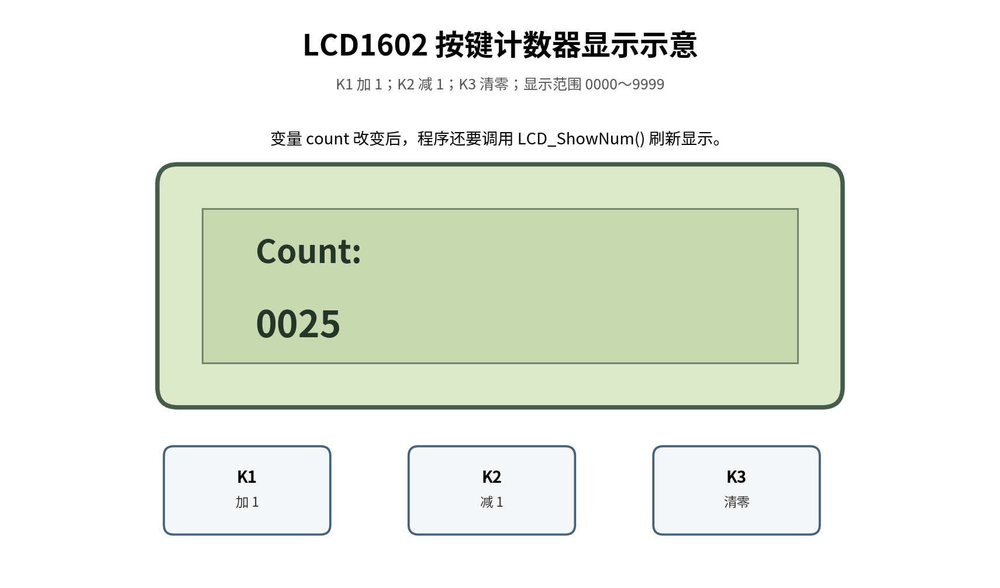

功能设定：

-   K1：加 1。
-   K2：减 1。
-   K3：清零。
-   K4：本例暂不使用。
-   第一行显示 `Count:`，第二行显示四位计数值。

``` c
unsigned int count = 0;
unsigned char key;

void main(void)
{
    LCD_Init();
    LCD_ShowString(1, 1, "Count:");
    LCD_ShowNum(2, 1, count, 4);

    while(1)
    {
        key = Key_Scan();

        if(key == 1)
        {
            if(count < 9999)
                count++;
        }
        else if(key == 2)
        {
            if(count > 0)
                count--;
        }
        else if(key == 3)
        {
            count = 0;
        }

        LCD_ShowNum(2, 1, count, 4);
    }
}
```

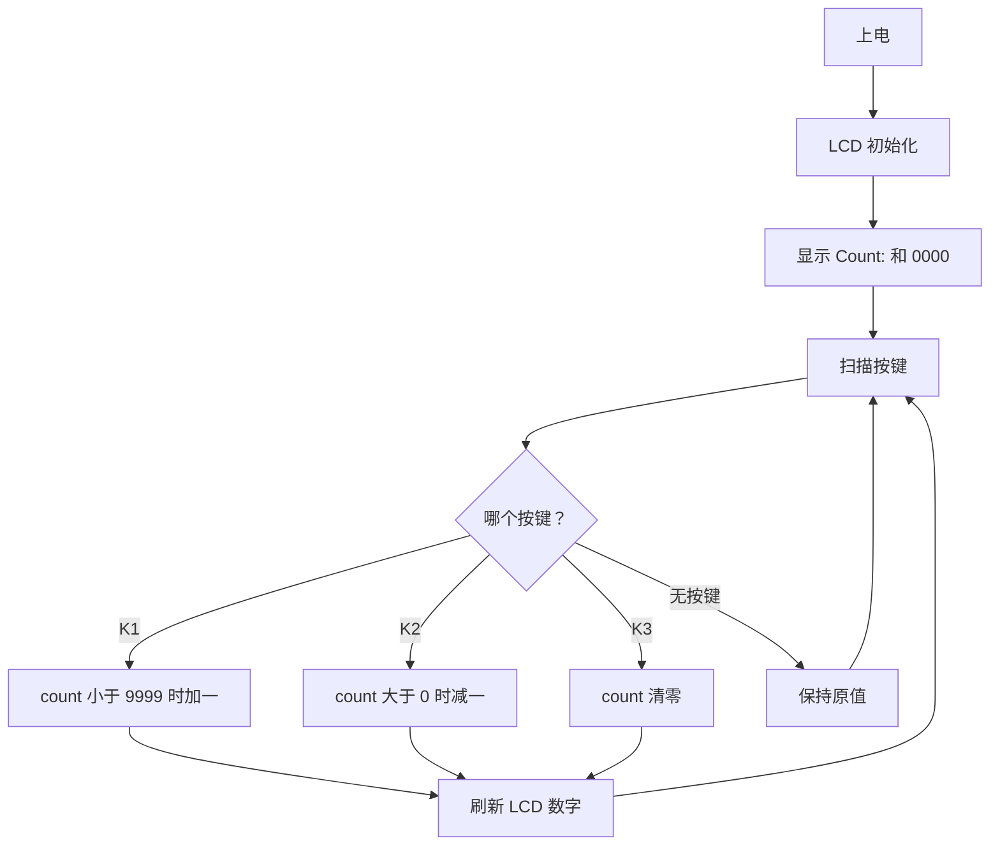

为什么要判断边界？

-   `count < 9999`：防止超过四位显示范围。
-   `count > 0`：防止无符号整数从 0 减 1 后回绕成很大的数。
-   `count++` 只修改内存变量，不会自动刷新 LCD，所以需要再次调用
    `LCD_ShowNum()`。

## 15. 阻塞式按键扫描与 LCD

典型阻塞式按键片段：

``` c
if(K1 == 0)
{
    DelayMs(10);
    if(K1 == 0)
    {
        while(K1 == 0);
        return 1;
    }
}
```

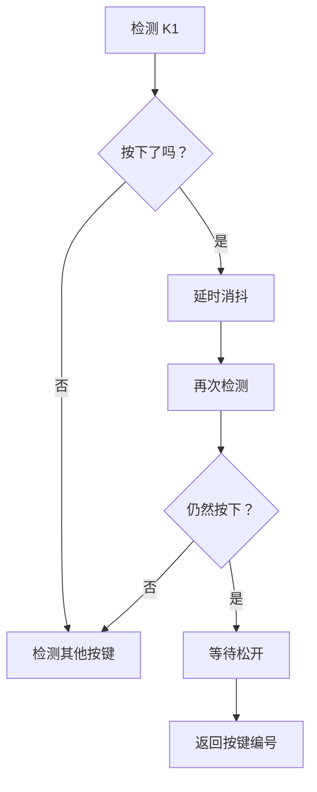

这种方法适合入门，但等待松开时主循环会停住。后续可用定时器做非阻塞消抖。定时器中断中只做简短采样、计数和事件标记；不要在中断中调用
LCD 显示函数或长延时，LCD 刷新放在主循环。

## 16. 驱动函数总览

| 函数 | 用途 |
|:--|:--|
| `DelayMs(ms)` | 软件延时 |
| `LCD_WriteCmd(cmd)` | 写命令 |
| `LCD_WriteData(dat)` | 写一个字符数据 |
| `LCD_Init()` | 初始化 |
| `LCD_SetCursor(row,col)` | 设置位置 |
| `LCD_ShowString(row,col,str)` | 显示字符串 |
| `LCD_ShowNum(row,col,num,len)` | 显示固定位数整数 |

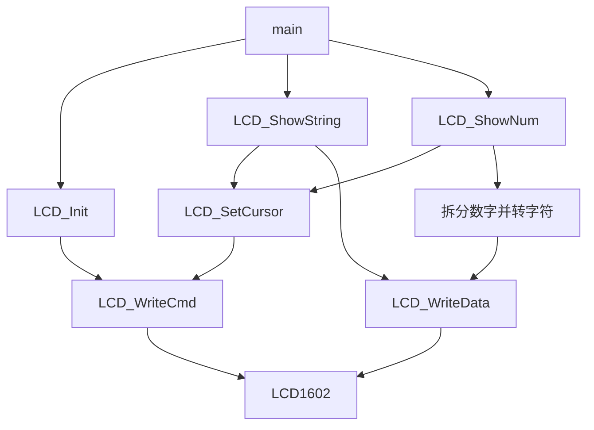

## 17. 常见故障排查

| 现象 | 优先检查 |
|:--|:--|
| 完全不显示 | 供电、对比度、排针方向、插接是否到位 |
| 有背光但无字符 | 对比度、初始化、RS/EN/RW 接线 |
| 乱码 | 数据线顺序、P0 上拉、初始化时序、数据稳定性 |
| 只显示部分字符 | 光标位置、字符串长度、是否超过 16 列 |
| 数字不正确 | `len`、除法取余、是否加 `'0'` |
| 变量变了屏幕没变 | 是否再次调用显示函数 |
| 更新很慢 | 是否频繁清屏、延时是否过长、是否重复刷新全部内容 |

建议按由简到繁的顺序调试：先初始化并显示固定字符串
`Hello`，再测试固定数字，最后接入按键和变量。不要一开始把
LCD、按键、定时器和复杂逻辑全部混在一起。

## 18. 一页速记

| 知识点 | 记忆内容 |
|:--|:--|
| LCD1602 | 16 列 × 2 行字符显示 |
| 数据线 | P0.0～P0.7 |
| 控制线 | RS=P2.6，RW=P2.5，EN=P2.7 |
| RS=0 / 1 | 命令 / 显示数据 |
| RW=0 / 1 | 写入 / 读取 |
| `0x38` | 8 位总线、两行、5×7 |
| `0x0C` | 显示开、光标关 |
| `0x06` | 地址自动递增 |
| `0x01` | 清屏 |
| `0x02` | 返回 Home（只回位、不清内容） |
| `0x40 \| n×8` | CGRAM 地址（n = 自定义字符编号） |
| `0x80 \| addr` | 设置 DDRAM 地址 |
| `0x28` | 4 位总线、两行、5×7 |
| 第一行首地址 | `0x80` |
| 第二行首地址 | `0xC0` |
| 显示字符 | `LCD_WriteData('1')` |
| 数值转字符 | `digit + '0'` |

## 19. 复习自测

1.  LCD1602 中的"1602"代表什么？
2.  普中 A2 上 D0～D7 连接到哪里？
3.  `RS=0` 和 `RS=1` 有什么区别？
4.  为什么当前程序将 RW 固定为 0？
5.  `0x38`、`0x0C`、`0x06`、`0x01` 分别做什么？
6.  `LCD_SetCursor(2,3)` 表示什么位置？
7.  为什么 `LCD_WriteData(1)` 不等于 `LCD_WriteData('1')`？
8.  `LCD_ShowNum(2,1,25,4)` 显示什么？
9.  为什么 `count++` 后还要调用显示函数？
10. 为什么无符号计数器减法前要判断 `count > 0`？
11. `0x01` 和 `0x02` 有什么区别？
12. 自定义一个 CGRAM 字符，要发哪几条指令？
13. 8 位模式和 4 位模式的功能设置指令分别是多少？

### 自测答案

1.  每行 16 个字符，共 2 行。
2.  P0.0～P0.7。
3.  RS=0 写命令，RS=1 写显示数据。
4.  当前驱动只写 LCD，不读 LCD。
5.  8 位总线双行设置；显示开光标关；地址递增；清屏。
6.  第二行第三列。
7.  数值 1 和字符 `'1'` 的 ASCII 编码不同。
8.  `0025`。
9.  修改变量不会自动刷新 LCD。
10. 防止无符号整数下溢回绕。
11. `0x01` 清空 DDRAM 内容并把光标回左上角；`0x02` 只把光标回左上角，显示内容保留。
12. 先发 `0x40 | (编号 × 8)` 设置 CGRAM 地址，再连续写 8 字节点阵数据，然后用 `0x80 | 地址` 回到 DDRAM，最后写编号 0x00～0x07 显示。
13. 8 位用 `0x38`，4 位用 `0x28`（都是双行、5×7）。

## 20. 后续学习路线

1.  把变量、传感器采样值显示到 LCD。
2.  用 K1～K4 做简单菜单和参数修改。
3.  只在显示内容变化时刷新对应位置，减少不必要写操作。
4.  把 CGRAM 自定义字符用到实际界面：图标、`℃`、进度条方块。
5.  试一次 4 位接线，把省下的 4 个 IO 让给其他外设。

> 本笔记的接线与代码对应当前学习使用的普中 A2 板和这套 LCD
> 驱动。更换开发板或 LCD 模块时，要重新核对原理图和模块数据手册。

---

## 相关笔记

- 索引：[[51单片机MOC]] · [[学习画像]]
- 前置：[[GPIO]] · [[静态数码管]] · [[动态数码管]]
- 关联：[[工具库]] · [[模块原理图]] · [[按键]]（按键计数器例子）
- 下一步：串口通信（笔记待建）

---

## 🧭 阅读顺序

⬅️ 上一篇：[[定时器与中断]] ｜ ➡️ 下一篇：[[工具库]] ｜ 🏠 返回索引：[[51单片机MOC]]
